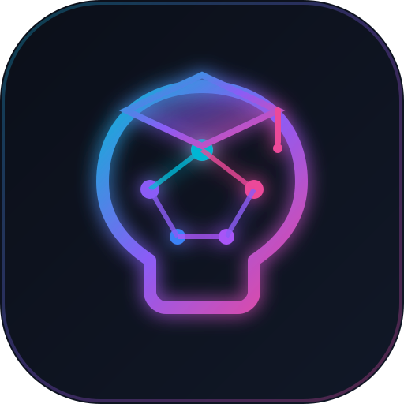

<!-- Created by 11Hopem -->
# 11AI Academy — Next-Gen AI Learning Platform & Prompt Lab

<p align="center">
  
</p>

<p align="center">
  
  
  
  
  
</p>

---

## 1. Vision & Concept
**11AI Academy** (`ai-learning-platform`) is an interactive, browser-native AI learning hub and prompt engineering laboratory built by [11Hopem](https://11hopem.com). It bridges the gap between theoretical artificial intelligence concepts and real-world production engineering—covering LLM architectures, context engineering, Model Context Protocol (MCP), agentic workflows, and diffusion media.

---

## 2. Live Links & Project Registry
- **Live Web Application**: [https://ai-learning-platform.vercel.app](https://ai-learning-platform.vercel.app)
- **Private GitHub Repository**: [https://github.com/umutocguder/ai-learning-platform](https://github.com/umutocguder/ai-learning-platform) *(Private)*
- **Firebase Project ID**: `hopem-software-cloud` (Cloud Firestore Europe `eur3`)
- **Author & Copyright**: Created by [11Hopem](https://11hopem.com)

---

## 3. Scope & Target Audience
- **Target Audience**: Software engineers, prompt engineers, AI creators, and tech leaders seeking structured mastery over generative AI and agentic systems.
- **Educational Scope**:
  - Foundations: Tokens, Context Windows, Attention Mechanisms, Sampling Parameters.
  - Engineering: Few-Shot In-Context Learning, Chain-of-Thought, Structured JSON Schemas.
  - Next-Gen Dev: Pair-programming with autonomous agents, AGENTS.md context standards, TDD with AI.
  - Autonomous Systems: Model Context Protocol (MCP), Tool Calling loops, Subagent patterns.
  - Creative Media: Sora, Kling, Runway Gen-3 cinematic video and Midjourney v6 formulas.
  - Enterprise Guard: RAG, Vector Embeddings, Indirect Prompt Injections, Hallucination mitigation.

---

## 4. Key Features & Interactive Modules
1. **Curriculum Explorer**: 6 core tracks with 14 in-depth interactive modules with code references and key takeaways.
2. **Interactive AI Prompt Evaluator**: Instant 4-dimensional scoring (Clarity, Context & Persona, Constraints, Formatting) with auto-enhanced prompt generation and constructive critique.
3. **Cheatsheet Vault**: One-click copy production prompt templates for Senior Architect refactoring, Autonomous Agent constitutions, and Cinematic video direction.
4. **Knowledge Assessment & Certification Exam**: 10-question evaluation engine awarding a verifiable 11Hopem AI Academy Certificate with unique ID upon achieving 70%+ score.
5. **Gamified Progress Tracking**: Local persistent XP calculation, learner tier ranking (Novice -> Grandmaster), and zero data loss via resilient local custody.

---

## 5. Architecture, Tech Stack & Directory Tree
- **Pure Web Architecture**: Zero framework overhead, zero hydration penalties, instant page loads.
- **Tech Stack**: Vanilla ES6+ Modules, Semantic HTML5, Custom Cyber Obsidian CSS, Cloud Firestore REST API.

```
ai-learning-platform/
├── assets/
│   └── images/
│       └── logo.svg                 # Master vector brand logo
├── public/
│   ├── index.html                   # Semantic markup, JSON-LD, SEO tags
│   ├── style.css                    # Dark cyber-obsidian design system
│   ├── app.js                       # Frontend client controller
│   ├── logo.svg                     # Synchronized brand logo
│   ├── favicon.svg                  # High-DPI SVG favicon
│   ├── favicon.ico                  # Fallback favicon
│   ├── robots.txt                   # Search crawler directives
│   ├── sitemap.xml                  # XML sitemap index
│   └── src/                         # Synchronized runtime modules
├── src/
│   ├── lib/
│   │   └── academyEngine.js         # Curriculum data, evaluator & quiz logic
│   └── telemetry/
│       └── firebaseLogger.js        # Non-blocking Firestore telemetry
├── scripts/
│   ├── build.js                     # Asset bundle & sync script
│   ├── backupService.js             # Rule 17 SHA-256 state ledger
│   └── lintCheck.js                 # Rule 20 static analysis
├── tests/
│   ├── blueprint.test.js            # Blueprint and brand tests
│   └── academy.test.js              # Unit tests for curriculum and engine
├── data/
│   └── backups/                     # Cryptographic snapshot backups
├── .github/
│   └── workflows/
│       └── ci-cd.yml                # Autonomous CI/CD pipeline
├── AGENTS.md                        # Architecture & agent instructions
├── CLAUDE.md                        # Sync pointer
├── WORKLOG.md                       # Project history & worklog
├── package.json                     # Package metadata
└── vercel.json                      # Vercel deployment configuration
```

---

## 6. Security, Anti-Bot & Legal Shield
- **PII Scrubbing**: Built-in automatic masking for credentials, tokens, credit cards, emails, and Turkish national identity numbers prior to log dispatch.
- **Security Headers**: Explicit Content Security Policy, `X-Content-Type-Options: nosniff`, `X-Frame-Options: DENY`, `X-XSS-Protection: 1; mode=block`.
- **Zero-Crash Telemetry**: Telemetry errors are caught and swallowed gracefully so application availability is 100% guaranteed.

---

## 7. Firebase Telemetry & Live Metrics (Rule 18)
Streaming real-time events to `hopem-software-cloud` Cloud Firestore REST endpoints:
- `telemetry_logs`: Prompt evaluations, module completions, quiz submissions.
- `visitor_logs`: Page sessions, lesson reads, feature interactions.
- `app_logs`: Client diagnostic events and performance benchmarks.

---

## 8. Autonomous Backup Engine (Rule 17)
Cryptographic SHA-256 state snapshot ledger located in `data/backups/`. Automatically executed prior to every test run:
```bash
npm run backup
```

---

## 9. Installation, Testing & Quality Verification
```bash
# Clone the repository
git clone https://github.com/umutocguder/ai-learning-platform.git
cd ai-learning-platform

# Synchronize runtime modules
npm run build

# Run automated test suite (Rule 8)
npm test

# Run static analysis & lint checks (Rule 20)
npm run lint

# Start local development server
npm start
```

---

## 10. Attribution & Legal Notice
Created by **[11Hopem](https://11hopem.com)**.  
Copyright &copy; 2026 11Hopem. All rights reserved.  
Official website: [https://11hopem.com](https://11hopem.com)
